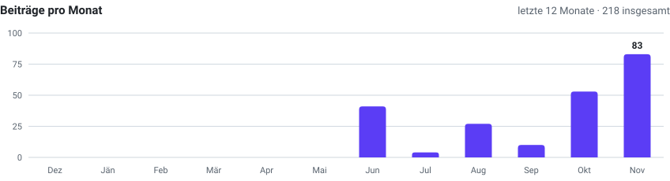
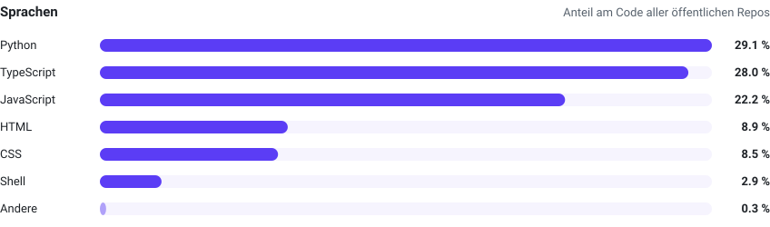

<picture>
  <source media="(prefers-color-scheme: dark)" srcset="assets/banner-dunkel.svg">
  
</picture>

Ich baue Webseiten, kleine Apps und betreibe meinen eigenen Server – alles selbst gehostet, ohne Tracking,
im selben Design: Himmel-Verlauf, Glas, Violett. Hier liegt der Code, die Geschichten dazu stehen auf
**[doc.slxt.dev](https://doc.slxt.dev)**.

<picture>
  <source media="(prefers-color-scheme: dark)" srcset="assets/kennzahlen-dunkel.svg">
  
</picture>

## Projekte

| | Projekt | Worum es geht |
|---|---|---|
| 💬 | **[disslxt](https://github.com/slxt47/disslxt)** | Eigene Chat-Plattform im Stil von Discord: Server, Kanäle, Anrufe, Freunde und Gruppen – TypeScript · [mehr](https://doc.slxt.dev/disslxt/) |
| 🖥️ | **[LinuxCommandCenter](https://github.com/slxt47/LinuxCommandCenter)** | Server-Dashboard mit Docker, VMs, Terminal, Rollen und Schutz-Paket (fail2ban, IDS) – Python |
| 🌌 | **[nexus](https://github.com/slxt47/nexus)** | Eigenes Microblogging: Posts, Hashtags, DMs, live per SSE, hell/dunkel – React · Express · PostgreSQL · [mehr](https://doc.slxt.dev/projekte/nexus/) |
| 🛍️ | **[webshop](https://github.com/slxt47/webshop)** | Dienstleistungen buchen ohne Konto, Bezahlung in Krypto, PDF-Rechnungen – Express · PostgreSQL · [mehr](https://doc.slxt.dev/projekte/webshop/) |
| ✨ | **[socials](https://github.com/slxt47/socials)** | Meine Startseite [slxt.org](https://slxt.org): Karte zum Werfen unter Sternschnuppen |
| 🍎 | **[port_apple](https://github.com/slxt47/port_apple)** | Mein Portfolio [slxt.dev](https://slxt.dev) im Apple-Stil |
| 🧾 | **[billing-web](https://github.com/slxt47/billing-web)** | Rechnungen, Angebote, Lieferscheine – selbst gehostet, PDF und E-Mail-Versand – Python · PostgreSQL |
| 🦾 | **[roboterarm](https://github.com/slxt47/roboterarm)** | 3D-gedruckter Roboterarm (EEZYbotARM MK2) mit Arduino und PS2-Gamepad – C++ |

Alle Repos im Überblick: [doc.slxt.dev → GitHub](https://doc.slxt.dev/projekte/github/)

## Aktivität

<picture>
  <source media="(prefers-color-scheme: dark)" srcset="assets/beitraege-dunkel.svg">
  
</picture>

<picture>
  <source media="(prefers-color-scheme: dark)" srcset="assets/sprachen-dunkel.svg">
  
</picture>

Die Diagramme erzeugt <a href="scripts/statistik.py">ein kleines Skript</a> jeden Montag neu (GitHub Action) – ohne fremde Dienste.

## Werkzeugkasten

Python · TypeScript · JavaScript · HTML/CSS · Shell · Docker · nginx · PostgreSQL · Cloudflare · Linux (Debian/Ubuntu) · Nextcloud

<a href="https://slxt.org">slxt.org</a> · <a href="https://slxt.dev">slxt.dev</a> · <a href="https://doc.slxt.dev">doc.slxt.dev</a>

