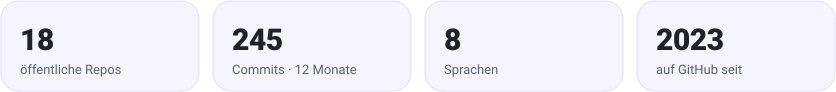
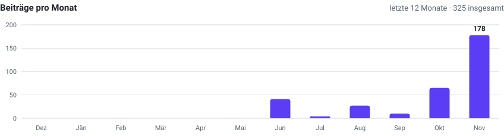
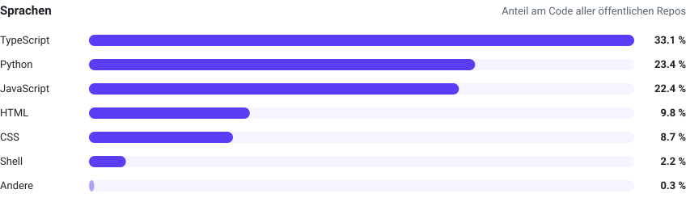

<picture>
  <source media="(prefers-color-scheme: dark)" srcset="assets/banner-dunkel.svg">
  
</picture>

Ich baue Webseiten, kleine Apps und betreibe meinen eigenen Server – alles selbst gehostet, ohne Tracking,
im selben Design: Himmel-Verlauf, Glas, Violett. Hier liegt der Code, die Geschichten dazu stehen auf
**[doc.slxt.dev](https://doc.slxt.dev)**.

<picture>
  <source media="(prefers-color-scheme: dark)" srcset="assets/kennzahlen-dunkel.svg">
  
</picture>

## Projekte

<!-- PROJEKTE:START -->
| | Projekt | Worum es geht |
|---|---|---|
| 📤 | **[share](https://github.com/slxt47/share)** | Dateien Ende-zu-Ende verschlüsselt teilen – Link oder QR-Code, Anmeldung mit E-Mail-Code, 1 GB gratis – Python · Web Crypto · [live](https://share.slxt.dev) · [mehr](https://doc.slxt.dev/projekte/share/) |
| 📡 | **[qr-stream](https://github.com/slxt47/qr-stream)** | Datei als verschlüsselte QR-Folge von Gerät zu Gerät – nur über die Kamera, Fountain-Code, PWA – JavaScript · [live](https://qr.slxt.dev) · [mehr](https://doc.slxt.dev/projekte/qr-stream/) |
| 💬 | **[disslxt](https://github.com/slxt47/disslxt)** | Eigene Chat-Plattform im Stil von Discord: Server, Kanäle, Anrufe, Freunde und Gruppen – TypeScript · [live](https://disslxt-info.slxt.org) · [mehr](https://doc.slxt.dev/disslxt/) |
| 🖥️ | **[LinuxCommandCenter](https://github.com/slxt47/LinuxCommandCenter)** | Server-Dashboard: Docker, VMs, Terminal, Rollen und Schutz-Paket (fail2ban, IDS) – Python |
| 🍎 | **[port_apple](https://github.com/slxt47/port_apple)** | Mein Portfolio slxt.dev im Apple-Stil · [live](https://slxt.dev) |
| 🌦️ | **[nimbus](https://github.com/slxt47/nimbus)** | Nimbus – Wetter jetzt, 24 Stunden und 14 Tage im slxt-Design (weather.slxt.org) – JavaScript · [live](https://weather.slxt.org) · [mehr](https://doc.slxt.dev/projekte/nimbus/) |
| 🌅 | **[zenit](https://github.com/slxt47/zenit)** | Zenit – Himmel je nach Tageszeit und Wetter, mit Uhr und Datum – JavaScript · [live](https://time.slxt.org) · [mehr](https://doc.slxt.dev/projekte/zenit/) |
| ☁️ | **[nextcloud](https://github.com/slxt47/nextcloud)** | Selbst gehostete Nextcloud mit Datenbank, Redis, Cron und Collabora Online – Docker Compose |
| 🛍️ | **[webshop](https://github.com/slxt47/webshop)** | Dienstleistungen buchen ohne Konto, Bezahlung in Krypto, PDF-Rechnungen – Express · PostgreSQL · [live](https://shop.slxt.org) · [mehr](https://doc.slxt.dev/projekte/webshop/) |
| 🦾 | **[roboterarm](https://github.com/slxt47/roboterarm)** | 3D-gedruckter Roboterarm (EEZYbotARM MK2) mit Arduino und PS2-Gamepad – C++ |
| 📄 | **[pdf_view](https://github.com/slxt47/pdf_view)** | Just a website to view PDF files – HTML |
| 🌌 | **[nexus](https://github.com/slxt47/nexus)** | Eigenes Microblogging: Posts, Hashtags, DMs, live per SSE, hell/dunkel – React · Express · PostgreSQL · [live](https://nexus.slxt.org) · [mehr](https://doc.slxt.dev/projekte/nexus/) |
<!-- PROJEKTE:END -->

Wird täglich automatisch aus meinen öffentlichen Repos erzeugt – das zuletzt geänderte steht oben.

Alle Repos im Überblick: [doc.slxt.dev → GitHub](https://doc.slxt.dev/projekte/github/)

## Aktivität

<picture>
  <source media="(prefers-color-scheme: dark)" srcset="assets/beitraege-dunkel.svg">
  
</picture>

<picture>
  <source media="(prefers-color-scheme: dark)" srcset="assets/sprachen-dunkel.svg">
  
</picture>

Die Diagramme erzeugt <a href="scripts/statistik.py">ein kleines Skript</a> jeden Montag neu (GitHub Action) – ohne fremde Dienste.

## Werkzeugkasten

Python · TypeScript · JavaScript · HTML/CSS · Shell · Docker · nginx · PostgreSQL · Cloudflare · Linux (Debian/Ubuntu) · Nextcloud

<a href="https://slxt.org">slxt.org</a> · <a href="https://slxt.dev">slxt.dev</a> · <a href="https://doc.slxt.dev">doc.slxt.dev</a>

